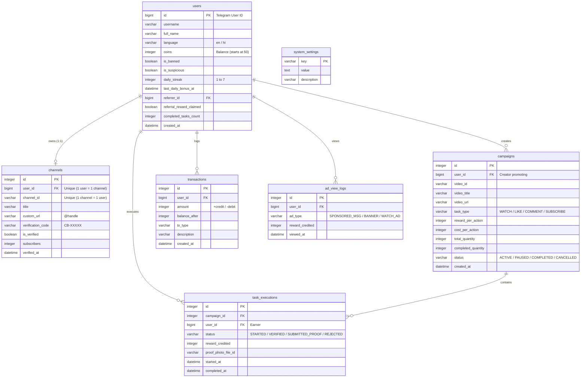

# 🚀 CreatorBoost Bot

> **A high-performance creator-exchange & monetization platform built for YouTube creators on Telegram.**  
> Earn coins by engaging with fellow creators' videos, spend coins to promote your own content, and monetize through built-in advertising networks and coin packs.

---

## 🛠 TECH STACK
- **Python 3.11+**
- **aiogram 3.x** (Async Telegram Bot Framework, FSMContext, Middleware)
- **SQLAlchemy 2.0 Async** (SQLite via `aiosqlite` local, ready for PostgreSQL via `asyncpg`)
- **YouTube Data API v3** (Direct API Key integration via `aiohttp` - **NO Google OAuth required**)
- **Pydantic v2 & python-dotenv** (Strict configuration validation)
- **Monetization**: Sponsored text snippets, banner ads, "Watch Ad, Earn Coins" engine, AdsGram stub, Telegram Stars (XTR), and manual UPI deposits.

---

## 📂 PROJECT STRUCTURE
```
CreatorBoost_Bot/
├── .env.example                # Template for environment variables
├── requirements.txt            # Python dependencies
├── config.py                   # Central settings validator (Pydantic BaseSettings)
├── main.py                     # Entry point (initializes DB, middlewares, long-polling)
├── database/
│   ├── connection.py           # Async SQLAlchemy engine & session factory
│   ├── models.py               # Declarative ORM models (User, Channel, Campaign, etc.)
│   └── crud.py                 # Pure async database queries & transactions
├── services/
│   ├── youtube.py              # Async YouTube API v3 client with TTL caching & quota handling
│   ├── anti_abuse.py           # Rate limiting, cooldowns & timer verification
│   └── i18n.py                 # Complete English & Hindi bilingual translations
├── ads/
│   ├── manager.py              # Sponsored snippet injector, banner ad & watch-ad engine
│   └── adsgram.py              # AdsGram network integration stub & signature validator
├── bot/
│   ├── keyboards/
│   │   ├── inline.py           # Main menu, language, task claim & coin shop keyboards
│   │   └── admin.py            # Admin moderation, proof approval & toggle switches
│   ├── middlewares/
│   │   ├── auth.py             # User registration, language detection & ban enforcement
│   │   └── rate_limit.py       # Leaky-bucket click & flood protection
│   └── states/
│       └── user_states.py      # FSM states (channel verify, campaign create, proof upload)
├── handlers/
│   ├── start.py                # /start, language toggle, main menu routing
│   ├── channel.py              # Channel ownership verification via code in About
│   ├── earn.py                 # Task queue, watch countdown timer, proof submission
│   ├── promote.py              # Campaign launch, budget deduction, pause & refund
│   ├── wallet.py               # Coin balance, transaction logs & history
│   ├── referral.py             # Viral referral engine with qualification tracker
│   ├── daily.py                # 7-day streak bonus system
│   ├── ads_handler.py          # "Watch Ad, Earn Coins" with daily frequency caps
│   ├── payment.py              # Telegram Stars (XTR) invoices & UPI guide
│   └── admin.py                # /admin command center, stats, proof review, broadcasts
└── utils/
    ├── helpers.py              # Code generators & text formatters
    └── logger.py               # Standardized logging setup
```

---

## 🗄 DATABASE SCHEMA



---

## 🔑 HOW TO GET CREDENTIALS

### 1. Telegram Bot Token (`BOT_TOKEN`)
1. Open Telegram and search for **[@BotFather](https://t.me/BotFather)**.
2. Send `/newbot`.
3. Choose a Display Name (e.g., `CreatorBoost Bot`).
4. Choose a unique Username ending in `bot` (e.g., `CreatorBoost_Official_Bot`).
5. Copy the **HTTP API Token** generated by BotFather.

### 2. Google YouTube Data API v3 Key (`YOUTUBE_API_KEY`)
1. Visit the [Google Cloud Console](https://console.cloud.google.com/).
2. Create a new project (e.g., `CreatorBoost Platform`).
3. In the navigation menu, go to **APIs & Services > Library**.
4. Search for **YouTube Data API v3** and click **Enable**.
5. Go to **APIs & Services > Credentials**.
6. Click **+ CREATE CREDENTIALS > API key**.
7. *(Recommended)* Click **Edit API Key** > under **API restrictions**, select **Restrict key** and check only **YouTube Data API v3**.
8. Copy your API key (starts with `AIza...`).

---

## ⚙️ INSTALLATION & SETUP

### Step 1: Clone or Navigate to Project
```bash
cd /Users/bajrangipanjiyar/Desktop/CreatorBoost_Bot
```

### Step 2: Create Virtual Environment
```bash
python3 -m venv venv
source venv/bin/activate
```

### Step 3: Install Dependencies
```bash
pip install -r requirements.txt
```

### Step 4: Configure Environment Variables
Create your `.env` file from the provided template:
```bash
cp .env.example .env
nano .env   # Or open in VSCode / your favorite editor
```
Fill in your credentials:
```env
BOT_TOKEN=your_telegram_bot_token_here
YOUTUBE_API_KEY=your_google_youtube_api_key_here
ADMIN_IDS=7854748403
DATABASE_URL=sqlite+aiosqlite:///creatorboost.db
```

### Step 5: Launch the Bot
```bash
python3 main.py
```

---

## 🌐 PRODUCTION DEPLOYMENT (24/7 Free & Cheap Hosts)

The bot runs asynchronously using **long-polling**, meaning you do **not** need a domain, SSL certificate, or public IP to run it.

### Option A: Railway.app / Render.com / Koyeb
1. Push your project to GitHub.
2. In Railway or Render, select **Deploy from GitHub repo**.
3. Set Environment to **Python 3**.
4. Set Start Command:
   ```bash
   python3 main.py
   ```
5. Add your `.env` variables under the host's **Environment Variables** dashboard.

### Option B: Linux VPS (Ubuntu / Debian using systemd)
To keep the bot running 24/7 as a background service:
1. Create a service file:
   ```bash
   sudo nano /etc/systemd/system/creatorboost.service
   ```
2. Paste:
   ```ini
   [Unit]
   Description=CreatorBoost Telegram Bot Service
   After=network.target

   [Service]
   Type=simple
   User=ubuntu
   WorkingDirectory=/home/ubuntu/CreatorBoost_Bot
   ExecStart=/home/ubuntu/CreatorBoost_Bot/venv/bin/python3 main.py
   Restart=always
   RestartSec=5

   [Install]
   WantedBy=multi-user.target
   ```
3. Enable and start:
   ```bash
   sudo systemctl daemon-reload
   sudo systemctl enable creatorboost
   sudo systemctl start creatorboost
   sudo systemctl status creatorboost
   ```

---

## 🧪 SHORT TEST PLAN (MANUAL VERIFICATION)

Follow this step-by-step checklist to test all features:

| Step | Action | Expected Result |
| :---: | :--- | :--- |
| **1** | Send `/start` | Bot sends welcome greeting in English, credits 50 starter coins, and displays inline menu. |
| **2** | Click **🌐 Language** | Language switches to Hindi (`🇮🇳 हिन्दी`). Confirm all button titles change. Switch back to English. |
| **3** | Click **📺 My Channel** | Bot prompts for channel link or handle. |
| **4** | Send your YouTube link / `@handle` | Bot resolves channel, displays title & subscriber count, and provides a unique code (e.g. `CB-48291`). |
| **5** | Click **[🔍 Verify Now]** before pasting code | Bot rejects verification: *"We could not find the code in your channel's About section."* |
| **6** | Paste code in YouTube channel About & save; Click **[🔍 Verify Now]** | Bot confirms channel verified! Status changes to ✅ Verified. |
| **7** | Click **🚀 Promote Video** | Bot prompts for video URL. Send a valid YouTube video link. |
| **8** | Select Task Type (e.g. `👀 Watch Views`), enter quantity `10` | Bot calculates cost (`22 coins x 10 = 220`), deducts coins from wallet, and launches campaign. |
| **9** | Click **💰 Earn Coins** from another Telegram account | Bot serves the campaign video. Shows title, reward (+20 coins), and video link. |
| **10** | Click **[▶️ Open Video]**, then immediately click **[⏳ Watching...]** | Bot alerts: *"Still watching! Please wait X more seconds."* (Anti-abuse timer works). |
| **11** | Wait 45s, then click **[✅ Confirm & Claim]** | Coins credited (+20 coins). Sponsored ad snippet is displayed every N tasks. |
| **12** | Click **👛 My Wallet** | Verify balance reflects deductions and credits with detailed transaction history. |
| **13** | Click **🎁 Daily Bonus** | Day 1 streak claimed (+10 coins). Second click shows countdown timer until next claim. |
| **14** | Send `/admin` (as Admin) | Admin command center opens: check stats, proof queue, toggles, and broadcast test. |

---

## ⚠️ KNOWN LIMITATIONS OF YOUTUBE DATA API (API KEY ONLY) & SUGGESTIONS

### 1. What the YouTube API *CANNOT* Verify Without Google OAuth:
- **Viewer Likes**: YouTube does not provide an endpoint to check if an arbitrary viewer liked a video. Determining whether a specific user liked a video requires the viewer to authorize a Google OAuth consent screen with sensitive scopes (`youtube.force-ssl`), which creates severe onboarding friction.
- **Viewer Comments**: Checking if a specific user commented on a video requires searching through comment threads via `commentThreads.list`, which consumes 100 quota units per query and is slow for popular videos.
- **Real-Time Watch Time**: Google does not expose client-side video telemetry (e.g. whether the user actually kept the YouTube tab active or minimized it).
- **Private Subscriptions**: If a user has "Keep all my subscriptions private" enabled in YouTube settings (enabled by default for many accounts), `subscriptions.list` returns an empty array.

### 2. Our Production Hybrid Safeguards:
- **100% Cryptographic Ownership**: Users prove they actually own the channel by placing dynamic code `CB-XXXXX` in the channel's public description.
- **Server-Side Watch Timers**: Users must wait out the full duration (e.g., 45s) before the confirmation button unlocks.
- **Screenshot Proof Review**: For Like and Comment tasks, users upload a screenshot, which is held in an admin moderation queue (`/admin > Review Proofs`) for 1-click approval.
- **Public Subscription Detection**: Automatically verifies public subscriptions via the official API; if private, instructs the user on how to make it public or upload proof.

### 3. Suggestions for Future Upgrades:
1. **Telegram WebApp Mini-App Player**: Embed the YouTube IFrame Player API inside a Telegram WebApp (`t.me/bot/app`). The YouTube IFrame API emits native JavaScript events (`YT.PlayerState.PLAYING`, `YT.PlayerState.ENDED`, `getCurrentTime()`), allowing 100% automated watch-time tracking without screenshots!
2. **Computer Vision / OCR for Screenshot Proofs**: Integrate Tesseract OCR or Google Cloud Vision API to automatically inspect uploaded screenshots for the "Liked" thumbs-up icon or channel name, automating 90% of manual admin proof approvals.
3. **PostgreSQL Migration**: When scaling beyond 10,000 daily active users, update `DATABASE_URL` in `.env` to a managed PostgreSQL cluster (`postgresql+asyncpg://...`). The SQLAlchemy models and queries are already 100% PostgreSQL-compatible!
